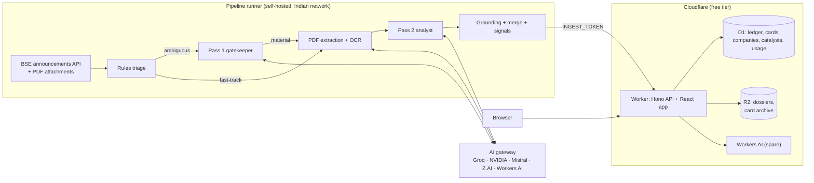

# BSE Corporate Intelligence & Persistent Memory Platform: Specification v2

v1 was the starting brief. This document is the revised design that the code in this
repository implements. Section 1 lists what changed and why. The rest describes the
system as built, with items still to build marked **Planned**.

---

## 1. What changed from v1, and why

| # | v1 | Problem | v2 |
|---|----|---------|----|
| 1 | Pipeline runs on GitHub-hosted runners (public repo) | BSE's API returned **403 Access Denied** to a non-Indian datacenter IP during development, even after a proper browser-style session warm-up. BSE's own `env.js` flags such visitors as `IS_INTERNATIONAL`. GitHub's Actions terms also exclude "activity unrelated to the software project" on GitHub-hosted runners. | The pipeline is a runner-agnostic Python CLI. The recommended home is a **self-hosted runner on an Indian network** (an old laptop, a mini PC or a Raspberry Pi), set with one repository variable. It reports a block clearly (`SourceBlockedError`) instead of returning empty results. |
| 2 | The LLM returns `updated_company_dossier`, rewriting the whole dossier on every filing | Rewrites drift and silently drop facts. A 5–15 KB dossier does not fit in `max_tokens: 2000`, so JSON gets truncated. One hallucination overwrites good history. | The LLM returns a small **delta** of facts stated in the filing. Deterministic code merges it, stamping every fact with `source_news_id` and `as_of`. Re-analysing a filing removes its old facts first, so merges are idempotent. Older filings never overwrite newer figures. |
| 3 | Backfill strictly in global chronological order | Order only matters *within* a company, and a global order serialises everything behind one queue. | Filings are processed oldest-first per company, with parallelism across companies. Memory is shown to the model through a **time-travel view** (`view_as_of`) containing only facts known before the filing, so live work and backfill can interleave without leaking future knowledge into older cards. |
| 4 | PDFs stored in R2 (`r2_pdf_link`) | About 300k filings since 1 Jan × roughly 0.5 MB each is about 150 GB, against a 10 GB free tier. Mirroring also redistributes BSE content. | Cards link to BSE's own attachment URL. R2 holds dossiers, a per-day card archive and backups. |
| 5 | Only a `cards` table, with one composite index | No work queue, no idempotency, no record of filtered filings. D1 bills **rows read** (5M/day free), and **every index entry written counts as a write** (100k/day). | A `filings` ledger (queue, retries, noise audit), plus `companies`, `catalysts`, `pipeline_runs`, `provider_usage` and `kv`. Indexes are chosen per read path, with FTS5 search, keyset pagination and bounded queries. Writes go through a daily D1 write budget. |
| 6 | `ai_router.py` as written | Construction fails at startup if any one key is missing (the OpenAI client raises without `api_key`). A bare `except` hides bad keys and deprecated models. There's no timeout (the SDK default is 600 s with 2 retries) and no JSON validation. `json_object` mode isn't supported by R1, which emits `<think>` blocks. The Z.AI URL points at the mainland `open.bigmodel.cn` platform, not global Z.AI. | A config-driven gateway (§4). Missing keys mean a skipped provider, not a crash. Errors are classified into failover, cooldown, retire-for-the-day or disable. It has strict timeouts, schema validation with a single repair attempt, reasoning stripping and quota persistence. |
| 7 | Groq Pass 1 on headline + page 1 of every filing | Groq's free tier for `llama-3.1-8b-instant` is token-limited (about 6K tokens/min and 500K/day at the time of writing; verify). 1,500 page-1 prompts a day exceeds that. | Rules drop the noise and **fast-track** clearly material categories (results, ratings, orders, M&A, USFDA, commissioning and so on) straight to Pass 2. Only ambiguous filings reach Pass 1, with at most 2,500 characters of page 1, on a multi-provider route. Backfill uses a bulk route led by Mistral's large monthly allowance. |
| 8 | NSE's 22-industry taxonomy | Many BSE-listed companies are not on NSE. | Sector lenses are matched against **BSE's industry string**, which covers every scrip. There are 21 lenses plus a default, covering the NSE sector families. |
| 9 | Mandatory "⚠️ MISSING DISCLOSURE" bullet | A mandatory slot invites invented omissions. | `missing_disclosures` is optional and evidence-based. |
| 10 | Scanned page = fewer than 50 characters | Short digital pages (a one-line cover letter) would be OCR'd. | Fewer than 50 characters **and** an embedded image, with a per-document OCR page budget. |
| 11 | Daily zipped dossiers committed to the repository | Binary zips bloat git history by about 10 MB/day and hit the 100 MB file limit. | Weekly export of **one JSON file per company** to a `backups` branch (small text diffs), plus the R2 card archive and D1 Time Travel. |
| 12 | Alerts for every high-impact card (Telegram, WhatsApp, X) | Out of scope by decision: the platform does not push to messaging or social channels. Push alerts would also need pacing, caps and a backfill guard. | The **website is the only distribution channel**. Every card has a permanent URL (`/feed?card=…`), a "Copy card as PNG" action, and a link to the official BSE PDF. |
| 13 | No hallucination checks | Mis-copied figures (a lakh/crore slip) are the most damaging error in this domain. | Each card's numbers are **grounded** against the filing and memory (§6). Cards below 70% are stored as `needs_review` and flagged on the card. |
| 14 | "Why it matters" left to the model | Plausible-sounding prose is not a signal. | **Signals computed in code** from extracted facts: promise vs delivery, follow-ups, dilution, working capital, metric shifts (§7). |
| 15 | "Quantified impact: compute exact math" | A confident ₹ estimate is the most persuasive and the least verifiable part of a card. | Each estimate carries its **working**: a formula over named inputs, each input labelled FILING, MEMORY or ASSUMPTION (with a reason). Code re-runs the arithmetic and checks FILING/MEMORY inputs against the sources. A mismatch sends the card to review (§6). |
| 16 | Not covered | Publishing impact ratings on listed stocks to the public is close to the SEBI (Research Analysts) Regulations and the finfluencer rules. | Disclaimers everywhere, no buy/sell calls or price targets (enforced in the prompt), summaries of public disclosures only. Get legal advice before monetising. See §13. |

---

## 2. Architecture



Repository layout:

| Path | What |
|---|---|
| `db/` | D1 schema (`migrations/`) and every SQL statement (`statements/`, `queries/`), shared verbatim by the Worker and the Python LocalSink |
| `pipeline/` | Python package `bse_intel`: fetcher, rules, extraction, gateway, prompts, memory, signals, sinks, market data, CLI |
| `pipeline/config/` | Everything tunable without code: `providers.toml`, `taxonomy.toml`, `events.toml`, `sectors.toml`, `market.toml`, `prompts/*.md` |
| `web/` | Cloudflare Worker (Hono) serving the API and the React app (Vite + Tailwind + Radix + TanStack) |
| `.github/workflows/` | CI, pipeline, market data, deploy, backup |

---

## 3. Pipeline

The owner's master blueprint is [BLUEPRINT.md](BLUEPRINT.md); what is built and what is
left is tracked in [TRACKER.md](TRACKER.md).

**Where it runs.** On an Indian connection (BSE refuses datacenter IPs). History from
`BACKFILL_START` (default **2025-01-01**) to today is filled on the owner's laptop against
the *local* Worker (`npm run dev`, whose D1/R2 persist under `data/wrangler`): no free-tier
limits apply there except the AI providers'. `backfill-companies` runs the 5-company smoke
test first; once the local site looks right, `sync-to-cloud` copies everything to Cloudflare
(§8). Daily live runs then use the self-hosted runner (or the laptop) against the deployed
Worker.

A run (`python -m bse_intel run`) spends a time budget in two phases. State lives in D1/R2,
so a run can stop anywhere; each company's results are committed as soon as it finishes.

1. **Live.** Discover today's new filings (and yesterday's, before 09:00 IST). Paging stops at
   the first BSE page with nothing new. Process the **live window** (the last 7 days since go-live)
   oldest first; a company with a short unanalysed history (≤ 30 filings) gets it analysed first,
   a longer backlog sends the company to the front of the backfill and the live card is marked
   "memory still building".
2. **Backfill.** Discover more historical days, oldest first, within the D1 daily write budget;
   each finished day also gets one full closing pass. A weekday with no filings is checked again
   on the next run before the cursor moves on. Then analyse the history **company by company,
   largest market cap first**, each in date order (order rebuilt once a day, kept in kv).

The **investable universe** (blueprint §15): companies with a known market cap below
`UNIVERSE_MIN_MCAP_CR` (default ₹100 Cr) and not starred are skipped; their filings go to the
day's noise file with the reason. The list is built after `market-data` / `sync-companies` into
R2 `meta/universe.json`.

Per filing:

| Stage | What happens | Where |
|---|---|---|
| Fetch | Browser-style session, paged `AnnSubCategoryGetData` (0.5 s between pages, no page cap overrun, de-duplicated), PDF downloads paced 1.2–2.0 s with jitter. An API 403 is `SourceBlockedError`; an attachment 403/5xx/timeout fails that filing only (retried next run), and three refusals in a row stop the run after committing finished work. | `bse.py` |
| Rules | `DROP` noise, `CALENDAR` board-meeting intimations (date to the calendar), `FAST_TRACK` known events, else `PASS1`. Compound headlines that also carry results, an outcome or a board meeting are never dropped. | `rules.py`, `config/taxonomy.toml` |
| Duplicate | BSE asks for one submission per applicable subcategory, so one event can arrive several times (one results PDF as "Financial Results" and as "Outcome of Board Meeting"). Once its text is extracted, a filing is marked DUPLICATE of an earlier filing by the same company from the last 3 days only when its body (whitespace and covering-letter lines removed) is exactly the same, or is near-identical (word 5-gram Jaccard ≥ 0.9) and holds exactly the same numbers. Same-template filings with new figures (a corrected statement, monthly updates, orders, ratings) are therefore never skipped; anything titled corrigendum, revised, corrected, amended or similar never is either. The duplicate stays in the ledger as "duplicate of <news_id> (exact/near match)": no AI call, no card, no memory change. | `duplicates.py`, `pipeline.py` (`_duplicate_of`) |
| Pass 1 | Headline, BSE subject and page 1 return `{is_material, event_type, confidence, reason}`. | `config/prompts/pass1.md` |
| Extract | PyMuPDF text; pages under 80 characters with an image are OCR'd (GLM-4.6V, then Mistral, then Gemini Flash-Lite). Boilerplate lines (addresses, salutations, signatures) are removed. Text is cached in `data/text_cache/` so re-analysis never downloads or OCRs again; a mostly scanned document whose OCR failed is retried, not judged from its headline. | `extract.py` |
| Pass 2 | System = base + event module + sector lens + schema; user = filing + time-travel memory + peers + the owner's starred/noise examples + text. Prompts above ~12k tokens use the long-context route. | `prompts/engine.py`, `config/prompts/pass2*.md` |
| Validate | Lenient on shape (nulls, numbers as strings, lakh/million scaled to crore, copied schema placeholders treated as missing), strict on meaning. When the filing declares one unit other than crore ("(INR in Lakhs)"), the prompt names it and ₹ crore figures must match the filing at that unit's scale. | `models.py`, `grounding.py` |
| Check | Numbers, math and claims (§6); a failing card gets one second opinion from another provider, which may correct only the card. | `grounding.py`, `quant.py` |
| Merge | Delta merged into the dossier with provenance and `known_since` (§5). | `dossier.py` |
| Signals + score | Deterministic signals (§7) and the 0–100 actionability score with the 4 gates; impact comes from the score. | `signals.py`, `forensics.py`, `scoring.py` |
| Store | Dossier to R2; card, catalysts, company and ledger status to D1; card archived to `daily_feed/{date}.json`; after the run the homepage snapshot is republished. | `pipeline.py`, `sinks/` |

Rule-dropped noise is not stored in D1: each day's drops are R2 `noise/{date}/NNN.json` chunks
plus `noise_count:{date}` in kv (the noise audit reads them).

Failure handling: a bad filing is `FAILED` with its attempt total (retried on later runs, up to
`MAX_ATTEMPTS`, at most once per run); AI outages are transient and never use an attempt; quota
ceilings leave work `PENDING` for the next day.

---

## 4. AI gateway

Seven free providers behind one OpenAI-compatible gateway (`config/providers.toml`), **one key
per provider** (owner decision; no dual-key pool). Free-tier catalogues change often: `models`
lists what each provider serves today and `ai-check` sends one tiny request to every target.
Established models are preferred to the newest, which are often overloaded (owner decision D13).

| Provider | Models (October 2026) | Role | Routes |
|---|---|---|---|
| Groq | `openai/gpt-oss-20b` (reasoning low; 1,000 requests/day) | Fast gatekeeper | `pass1`, `pass1_bulk` |
| NVIDIA NIM | `nvidia/nemotron-3-super-120b-a12b` (reasoning stripped) | Primary deep analyst | `pass2`, `pass2_bulk`, `pass2_long` |
| Mistral (Free plan) | `ministral-8b-2512`, `ministral-14b-2512`, `mistral-small-2603` | Backfill workhorse, OCR fallback | all |
| Z.AI | `glm-4.7-flash` (200K), `glm-4.6v-flash` | Long documents, OCR | `pass1*`, `pass2*`, `vision` |
| Google Gemini (AI Studio) | `gemini-3.1-flash-lite`, `gemini-3.5-flash-lite`, `gemini-3.6-flash` (spare) | Gatekeeper, OCR, 1M-token spare | `pass1*`, `vision`, `pass2*` |
| Workers AI | `@cf/meta/llama-3.1-8b-instruct-fp8`, `@cf/meta/llama-3.3-70b-instruct-fp8-fast` | Spare, through this Worker | `pass1*`, `pass2*` |
| OpenRouter (free models) | `nvidia/nemotron-3-ultra-550b-a55b:free` (reasoning stripped), `nvidia/nemotron-3.5-super-vl:free` | A regular weighted share of the backfill (`pass2_bulk`, weight 1 each), spares elsewhere; 1,000 requests/day shared by all free models (credits bought once, 2026-10-16; the free models do not spend them), 10/min per model | `pass2*`, `pass2_long`, `vision` |

Plan notes: Mistral's Free plan blocks `mistral-large` (403 "not available in your subscription
tier") and includes $10 of API usage a month with pay-as-you-go off, so it cannot bill. Gemini's
free limits are per Google project and shown only in AI Studio; the config holds cautious guesses
(about 500 requests/day for Flash-Lite, 20 for Flash) until confirmed. `gemini-4-argon` and
`gemini-3.1-pro-preview` are paid-only. Workers AI goes through `web/worker/ai.ts`, which accepts
both the old `{response}` and the OpenAI-shaped reply and turns an object reply back into text;
local dev needs the binding's `"remote": true`, `npx wrangler login` and a workers.dev subdomain.

Rules (tested in `tests/test_gateway.py`): 95% safety ceiling on every limit, persisted in D1;
weighted round-robin for Pass 2; a `concurrency` limit caps requests in flight per model (Z.ai's
free GLM models allow one: the gateway waits up to 10 s for the slot, then tries the next model); 429 → cooldown, and a 429 that names a daily window retires the
model for the day (one that names a per-minute window, as Gemini's do, only cools down); 401 or a
key-level 403 disables **every model of that provider** for the run; a 403 about one model's tier
disables only that model; 404 and 410 (retired) disable the model; **timeouts, connection errors and
5xx are transient** (fail over; if nothing can serve, the filing waits without losing an attempt);
a 200 with a non-JSON body fails over; JSON mode is dropped only when the provider says it is
unsupported; invalid JSON gets one repair; JSON in a ```json fence is accepted; requests never start
after the run's deadline and each request's timeout is capped to the time left; reasoning blocks are
stripped even when only the closing `</think>` is present. When nothing can serve, minute limits
wait 60 s (up to 3 times, never past the deadline) and ceilings stop the route for the run; four
filings in a row left queued because every provider was busy stop the run (rerun later).

**Second opinion** (`SECOND_OPINION=1`). A card that fails the checks is sent once to a different
provider with the problems listed. "Fails" means it needs review, or any amount on it (not a
percentage) matches no source: a 10x unit slip in one key number leaves the match rate above the
review threshold. Only the corrected card is adopted (memory stays from the
first reply unless the verifier sent a fuller delta); it is published either way, "Verified
after a second check" or "Unverified".

---

## 5. Memory: Living Company Dossiers

`R2: memory/{scrip_code}.json`, schema version 3. Every fact carries provenance. Compartments
(blueprint §6):

| Field | Content |
|---|---|
| `financial_metrics[]` | One per (metric, period): `value` (latest restatement), `as_of` = **known_since** (when first stated; a later comparative never moves it), `sources[]` when restated. Kept per period kind by period end: 12 quarters, 6 years, 6 halves, 18 months |
| `segment_mix[]`, `balance_sheet[]`, `capital_actions[]` | Dated snapshots |
| `deals[]` | Orders, fundraises, capex, acquisitions with stage history (L1 → LoI → LoA → contract …), brownfield/greenfield, captive/merchant |
| `guidance[]` | Management promises with status history; re-analysing the source filing keeps later updates |
| `watchlist[]` | Follow-ups (KPI, approval, analyst concern); open items are never evicted |
| `predictions[]` | Numeric targets (Loop 2: metric, period, value, comparison) resolved MET/MISSED when that period's figures arrive |
| `identity` | Former names, subsidiaries, JVs, brands |
| `ownership[]` | Quarterly promoter / pledge / FII / DII / small holders |
| `governance` | Auditor opinion history |
| `operating_notes[]`, `timeline[]`, `upcoming_events[]`, `business_summary` | As before |

The prompt sees `view_as_of(dossier, filed_at)`: only facts known before the filing, compact
(≤ 6,000 chars). Signals, the footer and the results table read `dossier_as_of(…)`, the dossier
as it stood at the filing, so backfilled cards see no later facts (bi-temporal); today's price
and market cap are not used for filings older than the price.

---

## 6. Checks

**Numbers** (`grounding.py`): every figure in the headline, takeaway, facts, insights, key numbers,
notable changes and KPI targets is checked by kind: amounts with unit conversions (crore, lakh,
million, rupees); % as stated or as the change between neighbouring source figures; bps/pp as the
difference of nearby margins; a share, change or multiple only when it follows from a grounded
figure on the same card line. Period labels ("Q2FY27", "FY 2026-27"), dates, years and small bare
counts are skipped. **An unmatched ₹ figure in the headline always holds the card.**

**Math** (`quant.py`): estimates carry a formula over named inputs (FILING / MEMORY / ASSUMPTION);
a whitelisted evaluator (60 nodes, exponents ≤ 12) re-computes them within 2%.

**Claims**: "first", "maiden", "record" need the filing to say so near the same subject; a repeat
described in the filing defeats a "first"; "track record", "on record" and "record date" are not records.

`needs_review` = score below 0.7, an unmatched headline amount, a math mismatch or an unsupported
claim. The badge says "Numbers verified" only when every number matched, otherwise "N of M numbers
matched"; unverified cards carry the warning in the exported PNG too.

---

## 7. Signals and the actionability score

Computed in code from memory as of the filing:

| Signal | Computation |
|---|---|
| `PROMISE_DELIVERED` / `GUIDANCE_BREACH` / `WATCH_RESOLVED` | Validated updates against earlier guidance and follow-ups; overdue promises |
| `PREDICTION_RESOLVED` | A numeric target met or missed by the reported figure (Loop 2) |
| `DILUTION` | More shares %, post-money dilution new/(old+new), discount to close, price-to-book |
| `SCALE` / `ORDER_FLOW` | Deal size against revenue, market cap, net worth; an order among earlier ones; a stage update is not a new order |
| `WORKING_CAPITAL_STRAIN` / `METRIC_SHIFT` | On the filing's own latest period only (never comparatives) |
| `VOLUME_STREAK` / `QUARTER_PREVIEW` | Monthly volumes > 25% YoY for 2+ months; on a quarter's third month, the quarter vs a year ago |
| `OWNERSHIP_SHIFT` | Smart money accumulating vs retail distribution; pledge rise |
| `AUDIT_FLAG` | Qualified / adverse / disclaimer opinion, mid-term resignation, emphasis of matter |
| `BOARD_DELIBERATION` / `REG30_THRESHOLD` | Board meetings of 6+ hours; Reg 30 Schedule III Para B filings |

**Score** (`scoring.py`, blueprint §11): magnitude vs TTM revenue or market cap (30), margin and
operating leverage (25), funding and balance sheet (20), management credibility (15), disclosure
and price timing (10), penalties down to −50; a Gate 4 veto (unverified figures, auditor
qualification or resignation, issuer-not-cooperating rating, a re-counted order) caps it at 35.
Impact: ≥ 70 High, 40–69 Moderate, < 40 Low (the model's call is kept as `model_impact`). A **Top
Signal** scores ≥ 70, passes Gate 4 and two of Gates 1–3 (magnitude ≥ 15%; inflection; price not
run up, 1M ≤ 15%, 1W ≤ 10%, liquidity ≥ ₹50 lakh/day). Credibility = delivered ÷ (delivered +
broken) promises and predictions.

---

## 8. Storage and budgets

**D1** (`db/migrations/0001`–`0004`): `filings` (queue and ledger: PENDING / NOT_MATERIAL /
ANALYZED / FAILED / DUPLICATE, with subject and symbol; DUPLICATE needs no schema change), `cards` (with market session, actionability score,
signal flag), `companies` (with former names, BSE group, liquidity, credibility, watchlist),
`catalysts`, `card_feedback` (owner's Star/Noise), `pipeline_runs`, `provider_usage`, `kv`.
Every write is a whitelisted SQL file taking one JSON array; unchanged values cost no write
(kv, catalysts, the companies search trigger).

**Read budget (5M rows/day).** Every query is a range seek: the queue by `(status, filed_at)`,
the feed by `filed_at` bounds with the cursor folded in, search from bounded FTS candidates,
counts capped at 1,000–2,000. The homepage's default page and Top Signals are served from R2
`daily_feed/latest_snapshot.json` (published after each run), hot responses are memoised in the
isolate, and the Cache API is used on a custom domain.

**Write budget (100k rows/day).** Backfill discovery and analysis stop at `D1_DAILY_WRITE_BUDGET`
(80k); market-data and sync writes are counted too. Noise lives in R2.

**R2**: `memory/`, `daily_feed/` (card archive + snapshot), `noise/`, `meta/universe.json`, `backup/`.

**Laptop → cloud** (`sync-to-cloud`): companies, upcoming catalysts, pipeline state, recent and
queued ledger rows, all cards (oldest first) and changed R2 objects, through the same statements;
resumable (`data/sync_progress.json`) and stopped at the daily write budget. A card costs about
8 row writes, so ~50k historical cards take about five days; live runs continue meanwhile.

**Size.** D1's free database cap is 500 MB; the System page shows the size. Card JSON is the
main growth (~1–1.5 MB/day); compressing it or moving old card bodies to R2 is the lever.

---

## 9. API (Cloudflare Worker, Hono)

Public, read-only:

| Route | Returns |
|---|---|
| `GET /api/feed` | Cards; `from`, `to`, `impact`, `category`, `size`, `sector`, `session`, `watch`, `q`, `review`; `page` (50 a page, capped total) or `cursor` |
| `GET /api/signals` | Top Signals (`from` or `from_at`) |
| `GET /api/brief?from_at=` | Pre-market brief: scanned, noise, cards, high, signals |
| `GET /api/cards/:id` | One card (links `/feed?card=…`) |
| `GET /api/noise?date=` | AI rejections (D1) and rule drops (R2) |
| `GET /api/search?q=` | Companies and cards (Ctrl+K) |
| `GET /api/companies`, `/api/companies/:scrip` | Directory; company, cards and dossier |
| `GET /api/calendar?from&to` | Catalysts |
| `GET /api/system` | Monitor: queue (capped), backfill companies, D1 writes and size, providers, runs |

Owner (`Authorization: Bearer OWNER_TOKEN`): `POST /api/owner/watchlist`, `POST/GET
/api/owner/feedback`, `GET /api/owner/check`.

Internal (`Bearer INGEST_TOKEN`): `POST /exec/:statement`, `POST /query/:name` (whitelisted SQL;
constraint errors return 400), R2 `GET/PUT /objects/{memory,daily_feed,backup,noise,meta}/…` and
listing by prefix, `POST /ai/v1/chat/completions` (Workers AI).

---

## 10. Frontend

React + Vite + Tailwind v4 + Radix + TanStack Query/Table, served as Worker static
assets. The layout and density are benchmarked on EquiSense's public pages (design
language only: no names, marks, scores or content are reused).

**Look and feel.** A calm, light canvas `#F8F9FB`, white surfaces with a 1px hairline
border and 12px radius, no shadows, one emerald accent `#059669`. Display headings in
DM Serif Display, interface text in Lexend, numbers in Inter (tabular), working and
formulas in JetBrains Mono. A dark theme with the same tokens follows the system
setting, with a light/dark/system toggle. One centred column, at most 1200px wide.

**Navigation.** A sticky top bar: Top signals, Live feed, Results, Companies, Calendar,
System. Search (Ctrl+K / ⌘K) finds companies and cards.

**Top signals (home, `/`).** The morning cockpit (blueprint view 1): cards that cleared the
four gates, best score first, for "since the 3:30 PM close" or the last 3 days, under a brief
(filings scanned, noise filtered, dossiers updated, signals).

**Live feed (`/feed`).** 50 cards a page with page numbers (owner decision), filters for
date range, size, sector, market session, verification and watchlist. Tabs by family (All, High impact, Results, Capex & orders, Capital &
deals, Governance & regulatory, Noise audit) and one filter row (date range, market cap,
sector, text). The default view is a column of **announcement cards**, one per filing,
readable in about ten seconds without opening anything:

1. ticker, market cap and size, and the impact pill (high / moderate / low);
2. chips: the event, up to two themes ("Renewables", "Infra / EPC"), the deal stage
   (LOI, LOA, MoU, development order, board approved: the provisional stages in amber)
   and the figures' basis (consolidated, standalone, proforma);
3. the headline: who did what, with the main figure, in proportion where memory allows;
4. for results, a small P&L (revenue, EBITDA, margin, PAT with YoY and QoQ) computed from
   the dossier; for concalls and presentations, the call read (guidance vs the last call,
   management tone, transparency, story) and up to four metric tiles;
5. two or three facts, with the key names and figures in bold (results bullets that only
   repeat the table are hidden);
6. a tinted box, "Why it matters" ("What these numbers mean" for results and business
   updates): up to four lines from the memory insights, the most important computed
   signal (marked "computed") and the first missing disclosure;
7. a footer with the latest revenue, the sector's own figures (GNPA/NIM for a bank, EBITDA/t for
   cement, ARPU for telecom, RevPAR for hotels…), 1W / 1M / 1Y, the time and session, the
   verification badge, and actions: Full analysis, PDF, copy as image, company, and for the
   owner Star signal / Mark noise. The header shows the 0–100 score (🔥 for a Top Signal),
   credibility and a thin-liquidity warning; a 📌 core-catalyst line sits under the headline.

"Full analysis" opens the rest underneath: remaining insights with their basis, every
quantified estimate with its working, all signals, notable changes, what to track next
(milestones, KPI to verify, pending approvals, growth catalyst, road blocker) and the
grounding detail. "Copy as image" exports the card alone, with the site name, date and
disclaimer, for sharing. A **List** toggle switches to compact expandable rows for fast
scanning. On wide screens a side rail shows today's numbers (filed, analysed, filtered
as noise) and the next seven days of catalysts.

**Results.** One table of results filings: date, company, verdict (Strong, Good, Mixed,
Weak, Neutral, from tone and impact), market cap, quarter, revenue / EBITDA / PAT YoY
and margin change in basis points, signals, PDF. Rows carry the tone stripe and expand
into the full card. Filters: quarter, verdict, size, company. The YoY figures come from
the dossier (`results_snapshot`), not from model prose.

**Company page** (`/company/:scrip`). Header with symbol, name, BSE code, last price
and 1W/1M/1Y, sector and size. Tabs:

| Tab | Shows |
|---|---|
| Overview | Key stats (market cap, size, revenue, debt, net worth, filings analysed); tiles for promise record, open commitments, latest filing tone and next catalyst; The story (business summary and latest read); How the story is unfolding (timeline); The good & the bad (signals and notable changes, de-duplicated); What to track |
| Results | Quarterly scorecard (verdict, takeaway, revenue / EBITDA / OPM / PAT YoY per quarter); financial baseline pivot by period kind; balance sheet |
| Promise tracker | Delivered / missed / open / delivery rate; every management commitment with given date, due date, status and evidence; follow-ups from earlier cards |
| Timeline | 2026 events, high-impact ones marked |
| Filings | The company's announcement cards |

**Companies.** Search, sort, size and coverage filters, A–Z; a table with sector,
market cap, returns, filings and last filing date. A row opens the company page.

**Calendar.** A month grid with dots coloured by family (corporate actions, meetings,
rights windows, execution milestones, accountability checks) and a "next 45 days"
agenda; on phones the agenda is the view.

**System.** Today's throughput, the queue, backfill progress (days discovered and
companies analysed), D1 writes and size, provider health meters with the 95% line, recent
runs (a run still RUNNING after the job timeout shows as STOPPED), and owner mode.

Every page, tab, filter and card is a URL.

---

## 11. Distribution

The website is the only channel. There is no Telegram, WhatsApp or X integration, and
no push messaging of any kind. Sharing works through each card's permanent URL
(`/feed?card=…`), the "Copy card as PNG" action, and the link to the official BSE filing.
The owner's ★ watchlist is on the site (owner mode).

---

## 12. Operations

**Where the pipeline runs.** Use a self-hosted GitHub Actions runner on an Indian home
or office connection. Set the repository variable `PIPELINE_RUNNER_LABELS` to
`["self-hosted","linux"]`.

- Self-hosted runner minutes are free on private repositories too. Because this
  repository is public, consider making it **private**: GitHub advises against
  self-hosted runners on public repositories, since fork pull requests can target
  them. (The workflows here never run the pipeline on `pull_request`, but private is
  safer.)
- GitHub-hosted runners remain the default and may work, but BSE can refuse them
  (see §1.1).

**Triggers.** cron-job.org calls
`POST https://api.github.com/repos/{owner}/{repo}/actions/workflows/pipeline.yml/dispatches`
with body `{"ref":"main"}` every 15–30 minutes. Use a fine-grained PAT scoped to this
repository with Actions read/write and nothing else. An hourly `schedule` is the
fallback. `concurrency: bse-pipeline` prevents overlapping runs, which the
single-writer design depends on.

**Secrets.**

| Where | What |
|---|---|
| Repository secrets | `PLATFORM_API_URL`, `INGEST_TOKEN`, `GROQ_API_KEY`, `NVIDIA_API_KEY`, `MISTRAL_API_KEY`, `ZAI_API_KEY`, `GEMINI_API_KEY`, `OPENROUTER_API_KEY`, and for deploys `CLOUDFLARE_API_TOKEN`, `CLOUDFLARE_ACCOUNT_ID` |
| Repository variables | `BACKFILL_START` (default 2025-01-01), `D1_DATABASE_ID`, `PIPELINE_RUNNER_LABELS` |
| Worker secrets | `INGEST_TOKEN`, `OWNER_TOKEN` (owner mode) |
| Optional env | `UNIVERSE_MIN_MCAP_CR` (100), `D1_DAILY_WRITE_BUDGET` (80000), `SECOND_OPINION` (1), `TEXT_CACHE` (1), `PIPELINE_WORKERS` (3) |

**Workflows.** `pipeline.yml` (live + backfill, 2,400 s inside a 55-minute job), `market-data.yml`
(weekdays 16:15 IST), `sync-companies.yml` (Saturdays 02:00 IST), `deploy-web.yml`, `backup.yml`,
`ci.yml`. On a self-hosted runner they use the runner's own Python in a venv.

**Backups.** The weekly `backup.yml` exports dossiers to the `backups` branch. R2
`daily_feed/` holds every card. D1 Time Travel gives point-in-time restore (7 days
on the free plan).

**Market data.** `market-data.yml` runs at 16:15 IST on weekdays: yfinance prices for
`{scrip}.BO` give returns, 30-day median traded value (liquidity) and, with weekly share
counts, market cap. Size tiers (blueprint): Micro < ₹500 Cr, Small < ₹5,000 Cr, Mid <
₹20,000 Cr, Large above. `market-data --all` covers every company (run on the laptop before
the backfill). Best-effort; never erases values. Each run rebuilds the universe file.

---

## 13. Compliance and risk

- **Not investment advice.** The product summarises public disclosures. Prompts forbid
  buy/sell recommendations and price targets, and every surface carries a disclaimer.
  Labelling impact on listed securities for a public audience is close to activities
  regulated under the SEBI (Research Analysts) Regulations, 2014, and SEBI's rules on
  association with unregistered "finfluencers". Take legal advice before monetising
  or growing a public channel.
- **BSE data.** The site's terms restrict automated access and commercial
  redistribution. The pipeline is polite (one paginated pass per run, delays,
  backoff), links to BSE for documents rather than mirroring them, and stores
  derived summaries. Review the terms for your use.
- **Model output.** Grounding, schema validation, provenance and code-computed signals
  reduce errors but cannot eliminate them. Every card links to the original filing.
- **Free tiers are not permanent.** Providers change limits and models. The gateway
  makes that a config edit, and the System view shows when a provider degrades.

---

## 14. Roadmap

Everything still to build before go-live, and its status, is in [TRACKER.md](TRACKER.md)
(owner decision: all of it is built and tested locally before launch).
