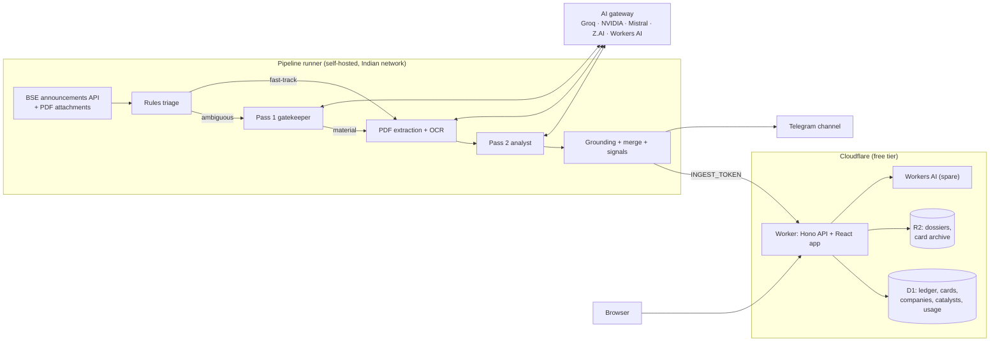

# BSE Corporate Intelligence & Persistent Memory Platform: Specification v2

v1 was the starting brief. This document is the revised design that the code in this
repository implements. Section 1 lists what changed and why. The rest describes the
system as built, with items still to build marked **Planned**.

---

## 1. What changed from v1, and why

| # | v1 | Problem | v2 |
|---|----|---------|----|
| 1 | Pipeline runs on GitHub-hosted runners (public repo) | BSE's API returned **403 Access Denied** to a non-Indian datacenter IP during development, even after a proper browser-style session warm-up. BSE's own `env.js` flags such visitors as `IS_INTERNATIONAL`. GitHub's Actions terms also exclude "activity unrelated to the software project" on GitHub-hosted runners. | The pipeline is a runner-agnostic Python CLI. The recommended home is a **self-hosted runner on an Indian network** (an old laptop, a mini PC or a Raspberry Pi), set with one repository variable. It reports a block clearly (`SourceBlockedError`) instead of returning empty results. |
| 2 | The LLM returns `updated_company_dossier`, rewriting the whole dossier on every filing | Rewrites drift and silently drop facts. A 5–15 KB dossier does not fit in `max_tokens: 2000`, so JSON gets truncated. One hallucination overwrites good history. | The LLM returns a small **delta** of facts stated in the filing. Deterministic code merges it, stamping every fact with `source_news_id` and `as_of`. Re-analysing a filing removes its old facts first, so merges are idempotent. Older filings never overwrite newer figures. |
| 3 | Backfill strictly in global chronological order | Order only matters *within* a company, and a global order serialises everything behind one queue. | Filings are processed oldest-first per company, with parallelism across companies. Memory is shown to the model through a **time-travel view** (`view_as_of`) containing only facts known before the filing, so live work and backfill can interleave without leaking future knowledge into older cards. |
| 4 | PDFs stored in R2 (`r2_pdf_link`) | About 300k filings since 1 Jan × roughly 0.5 MB each is about 150 GB, against a 10 GB free tier. Mirroring also redistributes BSE content. | Cards link to BSE's own attachment URL. R2 holds dossiers, a per-day card archive and backups. |
| 5 | Only a `cards` table, with one composite index | No work queue, no idempotency, no record of filtered filings. D1 bills **rows read** (5M/day free), and **every index entry written counts as a write** (100k/day). | A `filings` ledger (queue, retries, noise audit), plus `companies`, `catalysts`, `pipeline_runs`, `provider_usage` and `kv`. Indexes are chosen per read path, with FTS5 search, keyset pagination and bounded queries. Writes go through a daily D1 write budget. |
| 6 | `ai_router.py` as written | Construction fails at startup if any one key is missing (the OpenAI client raises without `api_key`). A bare `except` hides bad keys and deprecated models. There's no timeout (the SDK default is 600 s with 2 retries) and no JSON validation. `json_object` mode isn't supported by R1, which emits `<think>` blocks. The Z.AI URL points at the mainland `open.bigmodel.cn` platform, not global Z.AI. | A config-driven gateway (§4). Missing keys mean a skipped provider, not a crash. Errors are classified into failover, cooldown, retire-for-the-day or disable. It has strict timeouts, schema validation with a single repair attempt, reasoning stripping and quota persistence. |
| 7 | Groq Pass 1 on headline + page 1 of every filing | Groq's free tier for `llama-3.1-8b-instant` is token-limited (about 6K tokens/min and 500K/day at the time of writing; verify). 1,500 page-1 prompts a day exceeds that. | Rules drop the noise and **fast-track** clearly material categories (results, ratings, orders, M&A, USFDA, commissioning and so on) straight to Pass 2. Only ambiguous filings reach Pass 1, with at most 2,500 characters of page 1, on a multi-provider route. Backfill uses a bulk route led by Mistral's large monthly allowance. |
| 8 | NSE's 22-industry taxonomy | Many BSE-listed companies are not on NSE. | Sector lenses are matched against **BSE's industry string**, which covers every scrip. There are 21 lenses plus a default, covering the NSE sector families. |
| 9 | Mandatory "⚠️ MISSING DISCLOSURE" bullet | A mandatory slot invites invented omissions. | `missing_disclosures` is optional and evidence-based. |
| 10 | Scanned page = fewer than 50 characters | Short digital pages (a one-line cover letter) would be OCR'd. | Fewer than 50 characters **and** an embedded image, with a per-document OCR page budget. |
| 11 | Daily zipped dossiers committed to the repository | Binary zips bloat git history by about 10 MB/day and hit the 100 MB file limit. | Weekly export of **one JSON file per company** to a `backups` branch (small text diffs), plus the R2 card archive and D1 Time Travel. |
| 12 | Alerts for every high-impact card | Telegram allows about 20 messages a minute per channel, results season produces hundreds of HIGH cards, and backfill would alert on months-old news. | Paced at 3 s, capped per run, and sent only for HIGH impact + numbers verified + filed in the last 18 h. |
| 13 | No hallucination checks | Mis-copied figures (a lakh/crore slip) are the most damaging error in this domain. | Each card's numbers are **grounded** against the filing and memory (§6). Cards below 70% are stored as `needs_review` and never alerted. |
| 14 | "Why it matters" left to the model | Plausible-sounding prose is not a signal. | **Signals computed in code** from extracted facts: promise vs delivery, follow-ups, dilution, working capital, metric shifts (§7). |
| 15 | Not covered | Publishing impact ratings on listed stocks to the public is close to the SEBI (Research Analysts) Regulations and the finfluencer rules. | Disclaimers everywhere, no buy/sell calls or price targets (enforced in the prompt), summaries of public disclosures only. Get legal advice before monetising. See §13. |

---

## 2. Architecture

Repository layout:

| Path | What |
|---|---|
| `db/` | D1 schema (`migrations/`) and every SQL statement (`statements/`, `queries/`), shared verbatim by the Worker and the Python LocalSink |
| `pipeline/` | Python package `bse_intel`: fetcher, rules, extraction, gateway, prompts, memory, signals, sinks, Telegram, market data, CLI |
| `pipeline/config/` | Everything tunable without code: `providers.toml`, `taxonomy.toml`, `events.toml`, `sectors.toml`, `market.toml`, `prompts/*.md` |
| `web/` | Cloudflare Worker (Hono) serving the API and the React app (Vite + Tailwind + Radix + TanStack) |
| `.github/workflows/` | CI, pipeline, market data, deploy, backup |

---

## 3. Pipeline

A run (`python -m bse_intel run`) spends a time budget in two phases. Every step is
recorded in the D1 ledger, so a run can stop anywhere and the next one resumes.

1. **Live.** Discover today's filings (and yesterday's, before 09:00 IST), then process
   the live queue oldest-first.
2. **Backfill.** Discover more historical days, oldest first from `BACKFILL_START`
   (default 2026-01-01), within the D1 daily write budget. Then process the
   historical queue oldest-first on the bulk AI routes. Backfill never sends alerts.

Per filing:

| Stage | What happens | Where |
|---|---|---|
| Fetch | Browser-style session (warm-up on `/corporates/ann`, Referer/Origin headers), paginated `AnnSubCategoryGetData`, retries with backoff, `SourceBlockedError` on 403. Endpoint and parameters verified against BSE's current JS bundle. | `bse.py` |
| Rules | `DROP` (noise), `CALENDAR` (board-meeting intimations, with the meeting date extracted into the calendar), `FAST_TRACK` (known material event types) or `PASS1`. Rules are TOML with regexes and exclusions. | `rules.py`, `config/taxonomy.toml` |
| Pass 1 | Headline, category and the first 2,500 characters of page 1 return `{is_material, event_type, confidence, reason}`. | `prompts/engine.py`, `config/prompts/pass1.md` |
| Extract | PyMuPDF text for every page (serialised: PyMuPDF is not thread-safe). Scanned pages are rendered at 150 dpi and sent to the vision route, up to `MAX_OCR_PAGES`. The most relevant pages are picked within a character budget by event-type keywords (3× budget for concalls and presentations). | `extract.py` |
| Pass 2 | System prompt = base + event module + sector lens + output schema. User message = filing + time-travel memory + peer context + filing text. | `config/prompts/pass2*.md`, `events.toml`, `sectors.toml` |
| Validate | Lenient on shape (strings for lists, "₹1,234 Cr" for numbers, "HIGH IMPACT"), strict on meaning (enums, ISO dates, a card required when material). Hallucinated memory IDs are dropped. | `models.py` |
| Ground | Card numbers are checked against the sources (§6). | `grounding.py` |
| Merge | The delta is merged into the dossier with provenance; watch items are created from "track next". | `dossier.py` |
| Signals | Deterministic computations over the merged dossier (§7). | `signals.py` |
| Store | Dossier goes to R2. The card, catalysts, company row and ledger status go to D1. The card is also archived to `archive/cards/{date}.json`. | `pipeline.py`, `sinks/` |
| Alert | Telegram, under the conditions in §11. | `telegram.py` |

Failure handling: one bad filing is marked `FAILED` (retried up to `MAX_ATTEMPTS`)
and never stops the run. AI exhaustion is handled as in §4.

---

## 4. AI gateway

Five free providers behind one OpenAI-compatible gateway, configured entirely in
`pipeline/config/providers.toml`:

| Provider | Role | Routes |
|---|---|---|
| Groq `llama-3.1-8b-instant` | Fast live gatekeeper | `pass1` (primary), `pass1_bulk` |
| NVIDIA NIM `deepseek-ai/deepseek-r1`, `meta/llama-3.3-70b-instruct` | Deep analyst (R1 primary by weight; JSON mode off, `<think>` stripped) | `pass2`, `pass2_bulk` |
| Mistral `mistral-small-latest`, `mistral-large-latest`, `pixtral-12b-latest` | Backfill workhorse (provider-level monthly token ceiling), OCR fallback | all |
| Z.AI `glm-4.7-flash` (200K context), `glm-4.6v-flash` | Long documents, scanned-page OCR | `pass1`, `pass2`, `vision` |
| Cloudflare Workers AI `@cf/meta/llama-3.x` | Spare, used only after every other target fails. Called through this project's Worker (`/api/internal/ai/v1`), so the runner needs no Cloudflare key. | `pass1*`, `pass2*` |

Operating rules (all tested in `tests/test_gateway.py`):

- **95% safety ceiling.** Every limit (rpm, tpm, rpd, tpd, monthly requests/tokens) is
  scaled by `safety_ceiling`. A model leaves the pool at 95% of a daily or monthly
  quota. Daily and monthly usage is persisted in D1 (`provider_usage`), so the
  ceiling holds across stateless runs.
- **Never hammer one provider.** Pass 2 routes use smooth weighted round-robin.
  Pass 1 is priority order: Groq first, for speed.
- **Failover by error type.**

  | Error | Action |
  |---|---|
  | 429 | Cooldown for `Retry-After`; if the message mentions a daily quota, retire the model for the day |
  | 401/403 | Disable the model for the run |
  | 404 | Disable it: the model ID is wrong or deprecated |
  | 400 mentioning JSON mode | Retry once without JSON mode |
  | Timeout, connection error, 5xx | Count toward the circuit breaker (3 failures open it for 5 minutes) |
  | Invalid JSON | Ask the same model once to repair it, then fail over |
  | Prompt larger than `context_tokens` | Skip the model (long documents flow to GLM's 200K window) |

- **Graceful degradation.** If nothing can serve a request:
  - when the blockers are minute limits or cooldowns (`transient`), the pipeline waits
    60 s and retries, up to 3 times;
  - when they are daily or monthly ceilings (`quota_exhausted`), the filing stays
    `PENDING` in the D1 queue and the run stops cleanly.

  Nothing is dropped and no attempt counters are burned.

Model IDs and free-tier limits change often. They are config, not code, and the
values in `providers.toml` must be checked against each console.
`python -m bse_intel health` prints what is configured and today's usage.

---

## 5. Memory: Living Company Dossiers

`R2: memory/{scrip_code}.json`, schema version 2:

| Field | Content |
|---|---|
| `business_summary` | Set once, with provenance |
| `financial_metrics[]` | `{metric, period, value, unit, yoy_pct, qoq_pct, as_of, source_news_id}`, one per (metric, period); a later filing's restatement wins |
| `segment_mix[]`, `balance_sheet[]`, `capital_actions[]` | Dated snapshots with provenance |
| `guidance[]` | Management commitments: `{id: g_…, statement, target, due, due_date, given_on, status, status_history[]}` |
| `watchlist[]` | System follow-ups from "track next": `{id: w_…, kind: KPI\|APPROVAL, check_by, status, status_history[]}` |
| `timeline[]` | One entry per material filing: `{id: t_…, date, event_type, impact_level, summary, news_id}` |
| `upcoming_events[]` | Future dated events |

The prompt sees `view_as_of(dossier, filed_at)`. That is a compact view (≤6,000
characters, trimmed progressively) of only the facts known before the filing:
recent metrics per period kind, the latest balance sheet, open guidance (with
`overdue` flags), open watch items, the last N timeline entries and upcoming
events. The model cites memory by ID, and IDs not in the view are discarded.

**Promise vs delivery.** Guidance from AGMs, concalls and presentations gets an ID. A
later filing that delivers, delays, revises or misses it is reported by the model as a
`promise_update` against that ID. Code validates the ID and the chronology, then
updates the status history.

**Watch items.** "Track next" KPIs and pending approvals become watch items with a
check-by date (`Q3FY27 results` → 2026-12-31). Later filings resolve them as
MET / MISSED / PARTIAL.

---

## 6. Grounding check

Every number in the headline, the facts, key numbers and notable changes is searched
for in the filing text, the headline/subject and the memory view, allowing for:

- unit conversion (₹ lakh / million / thousand / rupees ↔ ₹ crore);
- display rounding (`₹1.2 Cr` matches `123.45` lakh);
- derived values: a YoY % from two source figures; bps and percentage-point changes
  as differences between two source percentages.

Years, period labels and small counts are skipped. The score is the share of numbers
grounded. Below 0.7 the card is stored with `needs_review` and is never alerted.

---

## 7. Signals (computed in code, not by the model)

| Signal | Computation |
|---|---|
| `PROMISE_DELIVERED` / `GUIDANCE_BREACH` | Validated promise updates against prior guidance, plus open guidance whose deadline has passed |
| `WATCH_RESOLVED` | A follow-up from an earlier card resolved by this filing |
| `DILUTION` | New shares ÷ pre-issue shares (from the filing, or the company's share count), the discount to last close, and the issue price ÷ book value per share (net worth from memory) |
| `WORKING_CAPITAL_STRAIN` | Receivables or inventory YoY growth exceeding revenue growth by 15 percentage points or more, same period |
| `METRIC_SHIFT` | A generic scan over *every* metric the filing reported: moves of 30% or more (200 bps or more for percentages) YoY or against the previous like period (quarter vs quarter, never quarter vs half-year), ranked by size, coloured by direction for common metrics, with trend-reversal notes |

On top of these, the analyst's open-ended `notable_changes` capture whatever else a
careful analyst would flag, for any announcement type. Their numbers are grounded
too. **Peer context** gives the analyst recent same-sector, same-event cards from D1,
so it can tell an industry-wide trend from company-specific share gains.

---

## 8. Storage and budgets

**D1** (`db/migrations/0001_init.sql`):

| Table | Purpose |
|---|---|
| `filings` | Ledger and queue: every filing with status `PENDING / DROPPED_RULE / NOT_MATERIAL / ANALYZED / FAILED`, route, reason, attempts |
| `cards` | One per material filing, with an FTS5 mirror |
| `companies` | Scrip master plus the market-data footer, with an FTS5 mirror |
| `catalysts` | Calendar entries |
| `pipeline_runs` | One row per run, for the monitor |
| `provider_usage` | Daily usage per model |
| `kv` | Small state: backfill cursors, write counters |

Every write is a whitelisted SQL file that takes **one JSON array parameter**
(`json_each`). That sidesteps D1's 100-bound-parameter limit, and the Worker binds
the request body without parsing it, keeping CPU time flat on the free plan.

**R2** layout:

| Key | Content |
|---|---|
| `memory/{scrip}.json` | Dossiers |
| `archive/cards/{date}.json` | Per-day card archive, enough to rebuild D1 without re-running AI |
| `backup/` | Reserved |

Budget estimates (measure with the System view and adjust):

| Item | Estimate |
|---|---|
| Filings/day | About 1,500; rules should drop or route 40–60% without AI (tune with the noise audit) |
| D1 writes, live | About 3 rows per new ledger row (row + 2 indexes) plus status updates: a few thousand a day |
| D1 writes, backfill | About 300k historical filings: roughly 1M row-writes, about 2 weeks at the default 80k/day budget |
| Pass 2 tokens | About 12–18k in and 1.5k out per filing; backfill of roughly 50–75k analyses ≈ 1B tokens, spread over weeks across providers (Mistral's monthly allowance does most of it) |

---

## 9. API (Cloudflare Worker, Hono)

Public, read-only, short edge-cache lifetimes:

| Route | Returns |
|---|---|
| `GET /api/feed` | Cards; `from`, `to`, `impact`, `category`, `size`, `sector`, `q` (FTS), `cursor`, `review` |
| `GET /api/cards/:id` | One card (Telegram deep links `/?card=…`) |
| `GET /api/noise?date=` | Filtered filings and why |
| `GET /api/search?q=` | Companies and cards (Ctrl+K) |
| `GET /api/companies` | Directory: `q`, `letter`, `sector`, `size`, `sort`, `all` |
| `GET /api/companies/:scrip` | Company row, cards and dossier |
| `GET /api/calendar?from&to` | Catalysts |
| `GET /api/system` | Monitor data |

Internal, `Authorization: Bearer INGEST_TOKEN`:

| Route | Does |
|---|---|
| `POST /api/internal/exec/:statement` | Runs a whitelisted write over a JSON array |
| `POST /api/internal/query/:name` | Runs a whitelisted read |
| `GET/PUT /api/internal/objects/{memory,archive,backup}/…` and `GET /api/internal/objects?prefix=` | R2 objects |
| `POST /api/internal/ai/v1/chat/completions` | Workers AI, OpenAI-compatible |

---

## 10. Frontend

React + Vite + Tailwind v4 + Radix + TanStack Query/Table, served as Worker static
assets.

**Aesthetic.** "Warm Institutional": alabaster `#F8F7F4`, white cards, sage memory
boxes `#EAF2EE` with forest headers `#1B4D3E`. OLED Midnight `#0B0F17` dark mode
(follows the system setting, with a toggle). Plus Jakarta Sans headings, Inter body
text, and JetBrains Mono tabular numbers.

**Live intelligence feed.** A sticky filter ribbon with filter text, Ctrl+K palette,
presets and date range, impact/event/market-cap pills, and the noise audit switch.
Each Super-Card shows:

- impact and category, company, time;
- the headline and key numbers;
- **what happened** (the facts) next to **why it matters** (memory and forensics,
  each insight labelled by basis), with missing disclosures;
- computed signals, notable changes, and what to track next;
- a financial footer (market cap, size, 1W/1M/1Y) and trust markers (numbers
  verified, partial memory);
- three actions: View PDF, Company memory, Copy PNG.

**Company memory directory.** A–Z, search, sort and size filters; TanStack Table.

**Catalyst calendar.** A month grid coloured by family: corporate actions, meetings,
rights windows, execution milestones, accountability checks (KPI checks, guidance
deadlines).

**System & AI monitor.** Today's throughput, the queue, backfill progress, provider
health meters with the 95% line, and recent runs.

**Company 360° drawer.**

1. Living dossier: summary, Promise vs Delivery table, watchlist, financial baseline
   pivot by period kind, balance sheet, upcoming events, capital actions.
2. 2026 timeline.
3. Filings & PDF: split view with an "open on BSE" fallback for when framing is
   blocked.

Every view, filter, drawer and card is a URL.

---

## 11. Distribution

**Telegram.** HTML messages with impact, company, headline, facts, insights, signals,
missing disclosures, "track next" and a disclaimer. Buttons: 🌐 View on site · 📄 PDF ·
📲 Share to WhatsApp (`wa.me/?text=`). Sent only for HIGH impact, numbers verified,
filed within 18 h, and never from backfill. Paced 3.1 s apart, capped at 40 per run,
honouring Telegram's `retry_after`.

**Planned.** Digest mode for MODERATE cards, per-user watchlists, and a WhatsApp channel.

---

## 12. Operations

**Where the pipeline runs.** Use a self-hosted GitHub Actions runner on an Indian home
or office connection. Set the repository variable `PIPELINE_RUNNER_LABELS` to
`["self-hosted","linux"]`.

- Self-hosted runner minutes are free on private repositories too. Because this
  repository is public, consider making it **private**: GitHub advises against
  self-hosted runners on public repositories, since fork pull requests can target
  them. (The workflows here never run the pipeline on `pull_request`, but private is
  safer.)
- GitHub-hosted runners remain the default and may work, but BSE can refuse them
  (see §1.1).

**Triggers.** cron-job.org calls
`POST https://api.github.com/repos/{owner}/{repo}/actions/workflows/pipeline.yml/dispatches`
with body `{"ref":"main"}` every 15–30 minutes. Use a fine-grained PAT scoped to this
repository with Actions read/write and nothing else. An hourly `schedule` is the
fallback. `concurrency: bse-pipeline` prevents overlapping runs, which the
single-writer design depends on.

**Secrets.**

| Where | What |
|---|---|
| Repository secrets | `PLATFORM_API_URL`, `INGEST_TOKEN`, `GROQ_API_KEY`, `NVIDIA_API_KEY`, `MISTRAL_API_KEY`, `ZAI_API_KEY`, `TELEGRAM_BOT_TOKEN`, `TELEGRAM_CHANNEL_ID`, and for deploys `CLOUDFLARE_API_TOKEN`, `CLOUDFLARE_ACCOUNT_ID` |
| Repository variables | `SITE_URL`, `BACKFILL_START`, `D1_DATABASE_ID`, `PIPELINE_RUNNER_LABELS` |
| Worker secret | `INGEST_TOKEN` |

**Backups.** The weekly `backup.yml` exports dossiers to the `backups` branch. R2
`archive/cards/` holds every card. D1 Time Travel gives point-in-time restore (7 days
on the free plan).

**Market data.** `market-data.yml` runs at 16:15 IST on weekdays. yfinance bulk price
download for `{scrip}.BO` tickers drives returns. Share counts are refreshed weekly
per ticker, which gives market cap. Size buckets are thresholds in `market.toml`;
align them with AMFI's semi-annual list. yfinance is unofficial and rate-limited, so
the job is best-effort and never erases existing values.

---

## 13. Compliance and risk

- **Not investment advice.** The product summarises public disclosures. Prompts forbid
  buy/sell recommendations and price targets, and every surface carries a disclaimer.
  Labelling impact on listed securities for a public audience is close to activities
  regulated under the SEBI (Research Analysts) Regulations, 2014, and SEBI's rules on
  association with unregistered "finfluencers". Take legal advice before monetising
  or growing a public channel.
- **BSE data.** The site's terms restrict automated access and commercial
  redistribution. The pipeline is polite (one paginated pass per run, delays,
  backoff), links to BSE for documents rather than mirroring them, and stores
  derived summaries. Review the terms for your use.
- **Model output.** Grounding, schema validation, provenance and code-computed signals
  reduce errors but cannot eliminate them. Every card links to the original filing.
- **Free tiers are not permanent.** Providers change limits and models. The gateway
  makes that a config edit, and the System view shows when a provider degrades.

---

## 14. Roadmap

| Item | Why |
|---|---|
| BSE corporate-actions feed for record, ex and payment dates | Authoritative calendar dates without AI |
| BSE bhavcopy for EOD prices (one official file a day) | Replaces per-ticker yfinance calls |
| AMFI classification import | Official Large/Mid/Small buckets |
| Re-analysis job for `memory_complete = 0` cards once backfill finishes | Live cards written before history loaded get full context |
| Pull-forward backfill | When a live filing arrives for a company whose history isn't loaded, load that company's results, concalls and AGM filings first |
| Evaluation harness: a golden set of real filings with expected facts | Compare prompts and models (fact recall, grounding score, JSON validity, latency, cost) before changing `providers.toml` |
| Annual reports | Section-aware extraction (MD&A, segment notes) instead of keyword page selection |
| Digest alerts, user watchlists, per-company RSS | Distribution |
